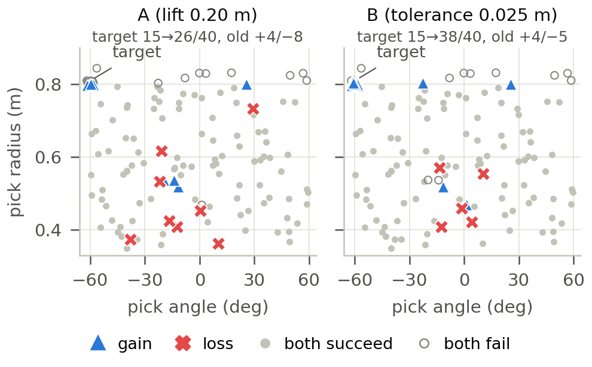

# Repair Without Regression?

**A budget-matched audit of an agent-edited robot skill.**

When a coding agent edits a persistent robot controller to fix a failure, a rise in aggregate success can hide losses on scenes the controller used to solve. This repository holds a fully controlled case study of that problem. It contains the simulator runner, the frozen protocols, every recorded rollout, the analysis scripts, the paper sources, and a small reusable toolkit, `regaudit`, that applies the protocol to other systems.

The setting is NVIDIA's scripted Franka pick-and-place controller in Isaac Sim 6.2. Outcomes are scored by an evaluator that reads object state from the simulator, independently of the controller's own success flag. The unchanged controller replays exactly, so every success-to-failure (or failure-to-success) flip after an edit is caused by the edit.



## Key findings

All results are for one robot, one task and one repair context.

- **Development pilot.** Two frozen repairs of a workspace-boundary failure fixed the target. They lost 4 and 1 of 44 earlier successes but gained more elsewhere, so aggregate admission and zero-loss admission disagreed.
- **Frozen audit (160 fresh scenes).** The compensation did not replicate. Both repairs improved the target neighbourhood, from 15/40 to 26/40 (A, lift height 0.20 m) and 38/40 (B, position tolerance 0.025 m). They also lost 8 and 5 of 106 old successes. Budget-matched gates, committed before the audit ran, rejected both.
- **Candidate populations (Extensions 1 and 2).** Two further populations of seeded random edits were audited. Across the two, all 21 target-improving candidates lost old successes, and different edits tended to break the same fragile scenes.
- **Extension 2 (pre-registered loss-history test).** The test used 24 new random edits. An 8-scene suite built from earlier edits' losses detected at least one loss in 14 of the 20 edits that had any. Eight random old scenes would be expected to detect 36%. The difference was +0.34 (95% CI 0.16–0.51).
- **Cost of the strict gate.** Used as a zero-loss gate, the history suite admitted 1 edit with 2 losses, where a random suite admitted 7 edits with 28 losses. It also rejected 9 of the 10 edits that were useful under an aggregate objective.

In this case, which old scenes the panel contained mattered more than which admission rule was used. The record of what past updates broke made a cheap regression suite for the next update.

## Repository layout

```text
.
├── paper/                     LaTeX sources, figures, tables and compiled PDFs (AAAI 2027 style)
├── outputs/
│   ├── robot_repair_study/    simulator runner, protocols, analysis scripts, all recorded results
│   ├── regression_audit_kit/  regaudit: the protocol as one dependency-free Python file
│   ├── *_report.md            write-ups of the pilot, audit and both extensions
│   ├── research_plan.md       staged research plan
│   └── audit_map.png, population_map.png
└── work/                      launch and queue scripts, artifact packaging, run logs
```

### `paper/`

| File | Contents |
|---|---|
| `main_ext2.tex` / `.pdf` | Submission manuscript, including Extension 2 |
| `main_ext2_short.tex` / `.pdf` | 4-page-total variant of the submission |
| `main.tex`, `main_short.tex` | Earlier version, without Extension 2 |
| `make_tables.py`, `make_population_table.py`, `make_combined_gate_table.py` | Generate every LaTeX table directly from the analysis JSON (no hand transcription) |
| `refs.bib`, `aaai2027.sty`, `aaai2027.bst` | Bibliography and the official style |

### `outputs/robot_repair_study/`

| Group | Files |
|---|---|
| Simulator runner | `run_stock_scene.py` (the only script that needs Isaac Sim) |
| Protocols | `pilot_protocol.md`, `radial_development_rule.md`, `boundary_development_rule.md`, `audit_protocol.md`, `audit_amendment_1.md`, `extension1_protocol.md`, `extension2_protocol.md` |
| Frozen hashes | `audit_frozen_hashes*.json`, `extension1_frozen_hashes.json`, `extension2_frozen_hashes.json` |
| Scene manifests | `*_scenes.json`, `ext2_suites.json`, generated by `make_audit_manifest.py`, `make_extension_manifest.py`, `make_ext2_materials.py` |
| Candidate edits | `proposals/` (repairs A and B, `ext1/` and `ext2/` random populations, `proposal_record.md`) |
| Gate decisions | `audit_gates.py`, `ext2_gates.py` |
| Frozen analyses | `analyze_audit.py`, `analyze_population.py`, `analyze_ext2.py` |
| Pilot diagnostics | `compare_pilot.py`, `pilot_diagnostics.py`, `scene_table.py`, `summarize_runs.py` |
| Post-hoc exploration | `explore_history*.py`, `explore_margin.py`, `explore_ext2_*.py` (labelled post hoc in each file) |
| Figures | `plot_audit_map.py`, `plot_population.py`, `plot_ext2.py`, `plot_pilot.py` |
| Paired-audit library | `audit.py`, with synthetic tests in `test_audit.py` |
| Recorded data | `results/`: rollout JSON, metadata, source snapshots and summaries for every batch |
| Environment | `environment-lock.txt` (pip freeze), `reproduction/` (launcher and Omniverse config) |

`outputs/robot_repair_study/README.md` gives the exact command for every reported number, figure and table.

### `work/`

PowerShell queues that ran each phase (`run_repair_batches.ps1`, `run_audit_batches.ps1`, `run_extension1.ps1`, `run_extension2.ps1`), the Isaac Sim launch wrappers, `freeze_ext2.py` for hashing the Extension 2 materials, `package_artifact.py` for building the anonymized review artifact, upstream copies of the NVIDIA controller and task for reference, and the stdout/stderr log of every batch. In the review artifact this folder is shipped as `scripts/`.

## Quick start (no simulator needed)

The toolkit and both unit-test suites run on synthetic fixtures with the Python standard library alone.

```bash
cd outputs/regression_audit_kit
python example_synthetic.py           # end-to-end demo on SYNTHETIC data
python -m unittest -v test_regaudit.py
```

```bash
cd outputs/robot_repair_study
python -m unittest -v test_audit.py   # synthetic fixtures, not robot results
```

## Using `regaudit` on your own system

`regaudit.py` implements the protocol in five steps:

1. **Certify replay** (`replay_check`). Run the unchanged parent twice on the same ordered scenes.
2. **Pair and split** (`directional`). Report old-scene losses and gains separately, with conditional loss and a Wilson interval.
3. **Calibrate** (`null_population`). Audit seeded random edits from the same bounded interface as a baseline.
4. **Keep a loss history** (`loss_history`, `history_suite`). Build a small suite from the scenes past edits broke most often.
5. **Gate, then audit** (`zero_loss_gate`). Commit the decision on the small suite, then run the full audit to measure what the gate missed.

The input is one record per rollout:

```python
{'config': 'parent' or an edit id, 'scene': 'scene id', 'success': 0 or 1}
```

See [`outputs/regression_audit_kit/README.md`](outputs/regression_audit_kit/README.md) for a full integration example and its limits.

## Reproducing the reported numbers

Every analysis recomputes its results from the recorded rollouts in `outputs/robot_repair_study/results/`. None of them re-runs the simulator. The analysis and plotting scripts need Python 3 with `numpy` and `matplotlib`. Commands are run from `outputs/robot_repair_study/`, and each script refuses to overwrite an existing output, so write to a new path to re-check a result. The full command list for the pilot, the audit and both extensions is in [`outputs/robot_repair_study/README.md`](outputs/robot_repair_study/README.md).

## Re-running the simulator

Re-running rollouts requires:

- Isaac Sim 6.2.0.0 with its Python 3.12 environment (package versions in `environment-lock.txt`)
- An NVIDIA GPU (the study used an RTX 4070 Ti SUPER with 16 GB). The stock task uses CPU physics at 60 Hz.
- Windows PowerShell for the provided queue and launch scripts

Launch through `work/launch_isaac.ps1` (or `launch_isaac_ps51.ps1` under PowerShell 5.1) rather than calling Python directly. The wrapper sets EULA acceptance, the local Omniverse config and writable Warp/CUDA caches. Edit the interpreter path in the wrapper for your machine. On first start, Isaac Sim may download assets and compile shaders. A rollout takes about 6.5 seconds, and all simulation runs serially.

### Evaluator

A rollout succeeds only if all of the following hold:

- The cube rises above 7.58 cm.
- It stays within 3 cm of the goal for the final 30 frames.
- It ends more than 8 cm from the grasp frame.
- Its final linear speed is below 0.02 m/s and its angular speed below 0.1 rad/s.
- Its orientation drift is below 0.05 rad.
- The task finishes before the horizon.

This is a pilot scoring rule, not a hardware safety definition.

## Building the paper

The official AAAI style requires pdfLaTeX (XeTeX is rejected):

```bash
cd paper
pdflatex main_ext2 && bibtex main_ext2 && pdflatex main_ext2 && pdflatex main_ext2
```

## Scope and limitations

- **One case.** The evidence comes from one robot, one task and one repair context, with two interactively proposed repairs and seeded random edits. It is not a general claim about agents, learned policies or physical safety.
- **Bounded edits.** The interventions are bounded parameter edits to a scripted controller. No neural policy was trained.
- **Run context.** A scene's outcome can depend on what ran before it in the same process, so compare parent and candidate in the same order.
- **No guarantee.** Zero observed losses on a small suite is not a safety guarantee.
- **Prior art.** Ordering tests by their failure history is established in software regression testing. The contribution here is controlled evidence that the idea carries over to an evolving robot skill.
- **Evidence labels.** Development data, frozen-audit data and post-hoc explorations are kept separate and labelled as such. They should not be pooled.
